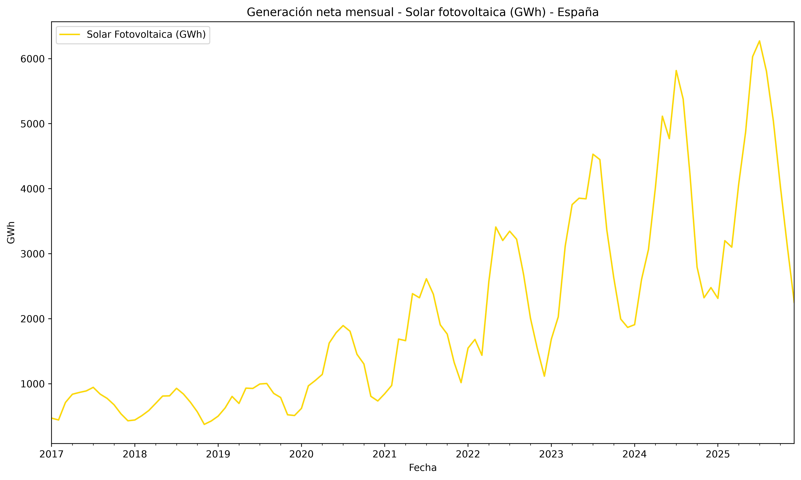
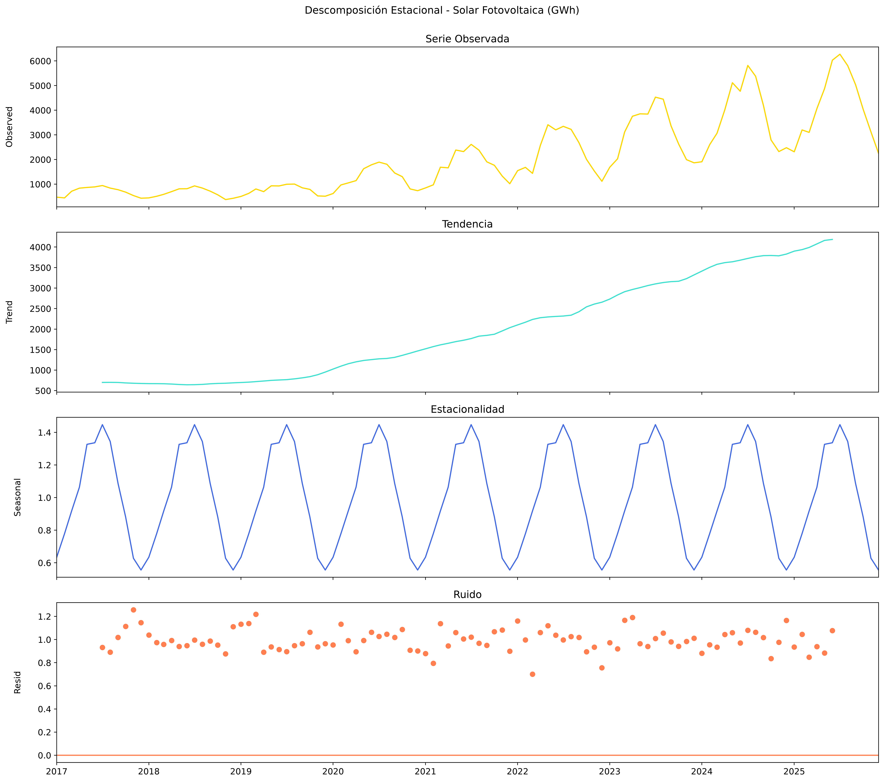
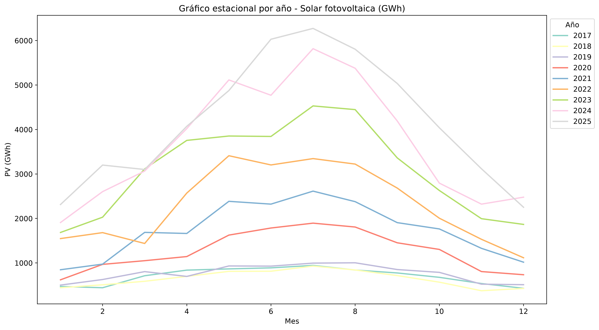
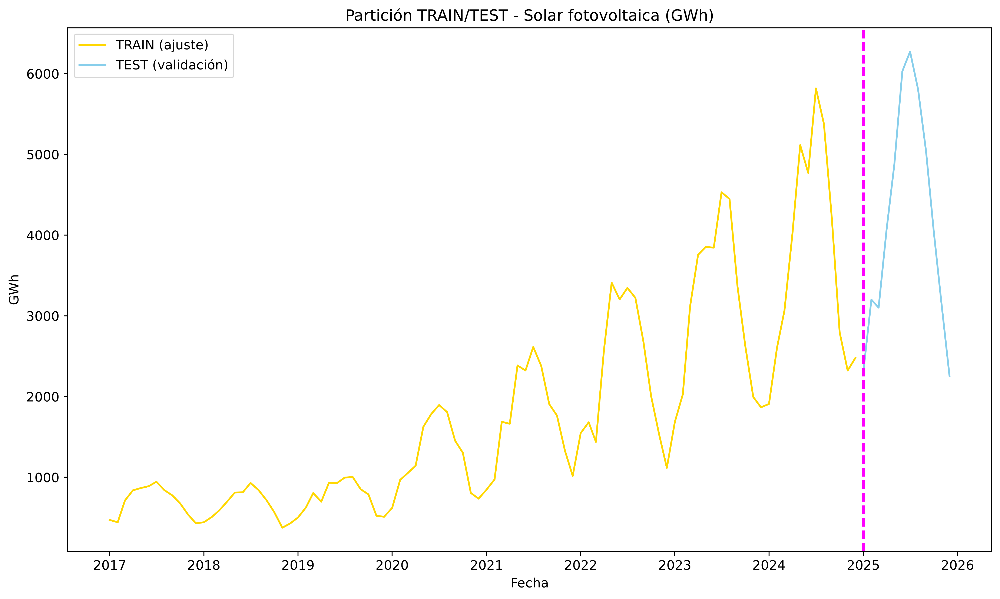
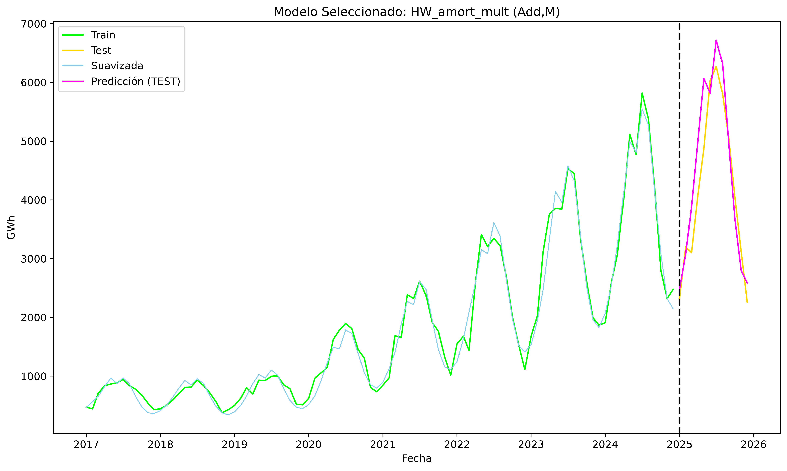
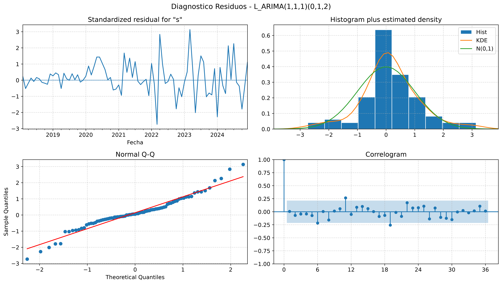
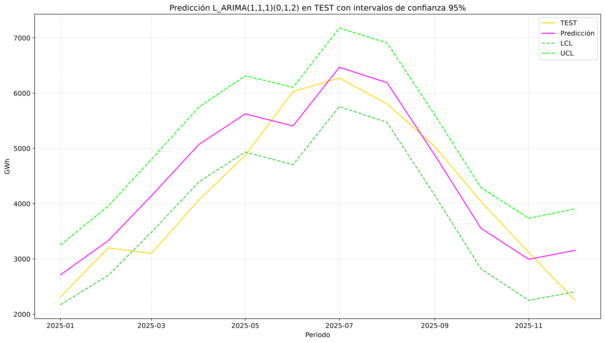
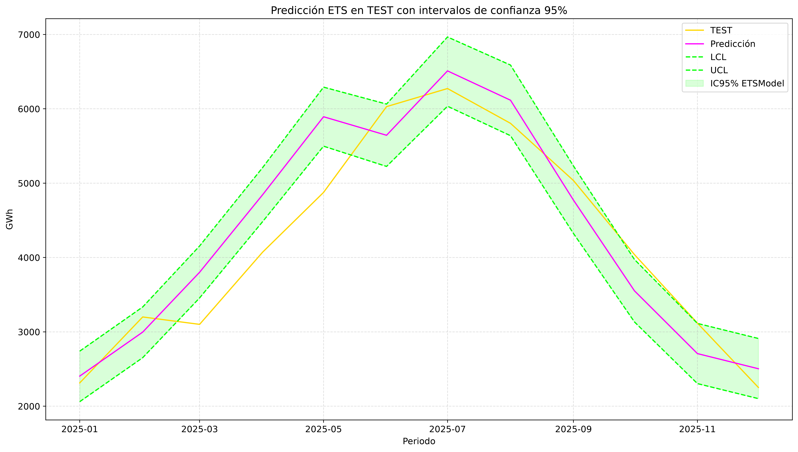
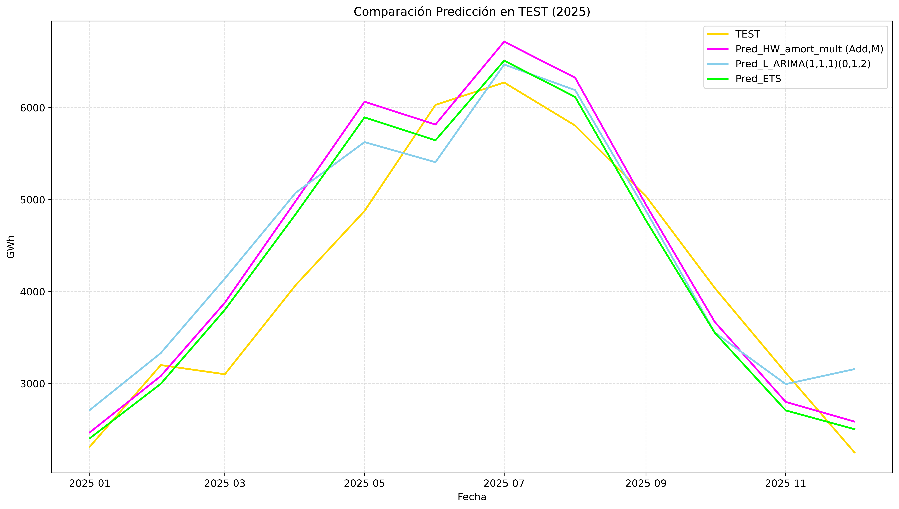
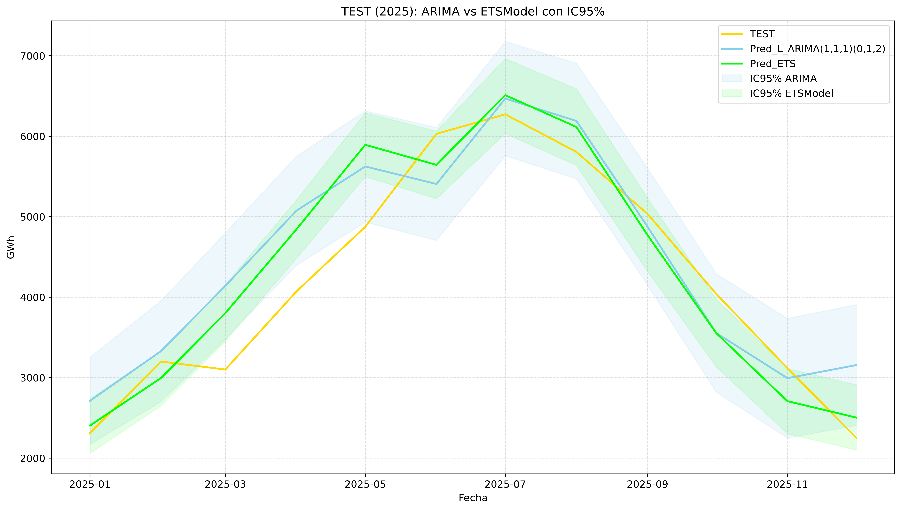

# Solar Time Series Forecasting · España

Proyecto de análisis y predicción de la **generación neta mensual de energía solar fotovoltaica en España**, expresada en GWh, a partir de datos de **Eurostat**.

El flujo cubre preparación y depuración de datos, análisis gráfico y estacional, partición temporal TRAIN/TEST, suavizado exponencial, SARIMA manual, AutoARIMA, predicción con intervalos de confianza, ETS en espacio de estados y comparación final.

## Datos y objetivo

- Periodo total: **enero de 2017 – diciembre de 2025**
- Observaciones: **108 meses**
- TRAIN: **2017-01 – 2024-12** (96 observaciones)
- TEST: **2025-01 – 2025-12** (12 observaciones)
- Periodicidad estacional: **m = 12**
- Serie principal: **Solar photovoltaic · Gigawatt-hour · Spain**

El objetivo es caracterizar la estructura temporal de la serie y comparar distintos enfoques de predicción sobre un periodo de validación separado.

## Fuente de datos

**Eurostat — Net electricity generation by type of fuel – monthly data (`nrg_cb_pem`)**

Extracción personalizada utilizada en el proyecto:

https://ec.europa.eu/eurostat/databrowser/view/nrg_cb_pem__custom_20190130/default/table

El pipeline espera el fichero:

```text
data/nrg_cb_pem__custom_20190130.xlsx
```

El archivo original de Eurostat no se incluye en el repositorio. En [`data/README.md`](data/README.md) se documentan la fuente, el alcance y la ubicación esperada.

## Flujo de trabajo

```text
01 Preparación y depuración del fichero Eurostat
        ↓
02 Representación y análisis estacional
        ↓
03 Partición temporal TRAIN / TEST
        ↓
04 Suavizado exponencial y Holt-Winters
        ↓
05 SARIMA manual y diagnóstico de residuos
        ↓
06 AutoARIMA y comparación con el modelo manual
        ↓
07 Predicción ARIMA e intervalos de confianza
        ↓
08 ETS en espacio de estados
        ↓
09 Comparación final de modelos
```

`run_pipeline.py` ejecuta secuencialmente las nueve etapas dentro del mismo proceso de Python, muestra resultados relevantes en consola y genera los artefactos de cada fase.

## Modelos evaluados

- Holt lineal.
- Holt amortiguado.
- Holt-Winters aditivo.
- Holt-Winters multiplicativo.
- Holt-Winters amortiguado multiplicativo.
- Modelos SARIMA identificados y evaluados manualmente.
- AutoARIMA con criterios AIC y BIC.
- ETS en espacio de estados.

El modelo ARIMA manual seleccionado es:

```text
SARIMA (1,1,1)(0,1,2)[12]
```

## Resultados en TEST · 2025

| Modelo | MAE | RMSE | MAPE |
|---|---:|---:|---:|
| Holt-Winters amortiguado multiplicativo | 454.1387 | 560.0580 | 11.5041 % |
| SARIMA (1,1,1)(0,1,2)[12] | 516.5473 | 612.1423 | 14.5255 % |
| ETS | **427.7202** | **501.1297** | **10.8290 %** |

En el TEST de 2025, **ETS obtiene los menores valores de MAE, RMSE y MAPE** entre los tres modelos finales comparados.

### Intervalos de predicción

| Modelo | Cobertura observada en TEST | Amplitud media |
|---|---:|---:|
| ARIMA | 66.67 % | 1380.3081 GWh |
| ETS | 58.33 % | 805.7591 GWh |

Sobre los 12 meses de TEST, ARIMA cubre más observaciones, mientras que los intervalos ETS son sensiblemente más estrechos.

Los resultados tabulares completos pueden consultarse directamente en:

- [`09_metricas_test.csv`](outputs/tablas/09_metricas_test.csv)
- [`09_predicciones_test.csv`](outputs/tablas/09_predicciones_test.csv)
- [`09_errores_test.csv`](outputs/tablas/09_errores_test.csv)
- [`09_comparacion_intervalos.csv`](outputs/tablas/09_comparacion_intervalos.csv)
- [`09_resumen_intervalos.csv`](outputs/tablas/09_resumen_intervalos.csv)

## Visualizaciones principales

### Serie temporal principal



### Descomposición estacional



### Perfil estacional por año



### Partición TRAIN / TEST



### Suavizado seleccionado



### Diagnóstico de residuos del ARIMA manual seleccionado



### Predicción ARIMA con IC 95 %



### Predicción ETS con IC 95 %



### Comparación final de predicciones



### ARIMA vs ETS · IC 95 %



## Estructura del repositorio

```text
solar-time-series-forecasting/
├── README.md
├── LICENSE
├── NOTICE.md
├── .gitignore
├── requirements.txt
├── environment.yml
├── conda-spec.txt
├── run_pipeline.py
├── data/
│   └── README.md
├── src/
│   ├── series_funciones.py
│   ├── 01_series_fichero.py
│   ├── 02_series_representacion.py
│   ├── 03_series_train_test.py
│   ├── 04_series_suavizado.py
│   ├── 05_series_arima_manual.py
│   ├── 06_series_arima_automatico.py
│   ├── 07_series_arima_prediccion.py
│   ├── 08_series_modelado_ets.py
│   └── 09_series_comparacion_final.py
├── images/
│   └── visualizaciones seleccionadas
└── outputs/
    ├── series_energia_solar.csv
    ├── pv_train_test.csv
    ├── tabla_coef_estacionalidad_PV.csv
    └── tablas/
        └── resultados finales de TEST
```

Los archivos `.pkl` intermedios no se publican: el pipeline los regenera durante la ejecución.

## Entorno y reproducibilidad

El proyecto se validó con el entorno Conda **`Series`**.

### Opción recomendada · recreación mediante `environment.yml`

```bash
conda env create -f environment.yml
conda activate Series
```

`environment.yml` corresponde al entorno completo realmente utilizado para desarrollar y validar el pipeline.

### Reproducción exacta en Windows `win-64`

Se incluye además `conda-spec.txt`, que contiene el snapshot explícito del entorno validado:

```bash
conda create --name Series --file conda-spec.txt
conda activate Series
```

Este archivo es específico de **Windows `win-64`**.

### Instalación mínima con `pip`

Como alternativa, `requirements.txt` contiene únicamente las dependencias principales del proyecto:

```bash
pip install -r requirements.txt
```

## Ejecución

1. Descargar la extracción de Eurostat.
2. Guardarla como:

```text
data/nrg_cb_pem__custom_20190130.xlsx
```

3. Ejecutar:

```bash
python run_pipeline.py
```

En Spyder, el uso de `runpy` mantiene las etapas dentro del mismo kernel y permite visualizar las figuras en el panel **Plots** cuando el backend gráfico está configurado para ello.

## Salidas incluidas

Se conserva una selección de resultados reproducibles:

- Dataset procesado de series solares.
- Partición TRAIN/TEST.
- Coeficientes estacionales.
- Predicciones y errores sobre TEST.
- Métricas finales.
- Intervalos de confianza ARIMA y ETS.
- Comparación y resumen de intervalos.

## Tecnologías

Python · Pandas · NumPy · Matplotlib · Seaborn · Statsmodels · pmdarima · scikit-learn · OpenPyXL

## Autor

**Carlos Ayllón Motto**

Proyecto desarrollado como trabajo aplicado de análisis y modelado de series temporales.

## Licencia

El código se distribuye bajo licencia **MIT**. Los datos de Eurostat mantienen sus propias condiciones de uso y reutilización.
